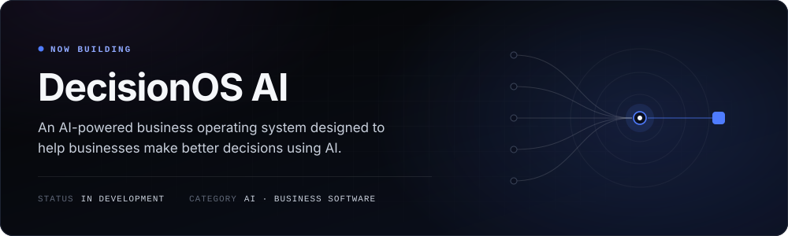
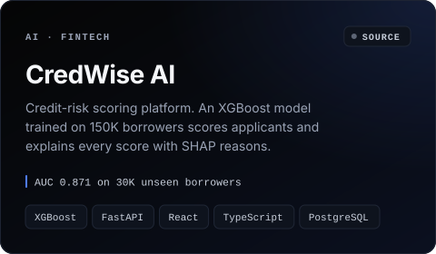
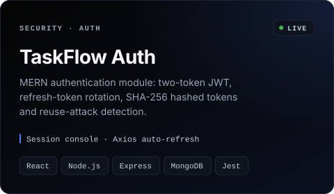

<!--
  Profile README for github.com/AKSHATHEHE11
  Every image in assets/ is generated by scripts/build.py. Edit the content there, then run:
      python scripts/build.py
  .github/workflows/refresh.yml re-runs it weekly so the activity card stays current.
-->

&nbsp;&nbsp;

## About

I'm a full-stack developer at **Imperial Tech Innovations**, where I help build and ship production web applications: e-commerce storefronts, admin portals, payment and shipping integrations, and the APIs behind them.

I work across the whole product: **React and Next.js** on the front, **Node.js and REST APIs** on the back, **AWS and Vercel** underneath, and **machine learning** when a problem needs a model instead of a rule.

- **Product first.** I start from the user journey and the business workflow, then pick the stack.
- **Full lifecycle.** Requirements, build, integrate, test, debug, optimise.
- **AI that explains itself.** My credit-risk model gives the reasons behind every score.

| Focus area | Tools |
|:--|:--|
| **Product engineering** | React · Next.js · TypeScript |
| **Backend & APIs** | Node.js · Express · FastAPI |
| **Cloud & delivery** | AWS · Vercel · Cloudinary |
| **Applied AI / ML** | XGBoost · scikit-learn · OpenCV |

## Stack

| | |
|:--|:--|
| **Languages** | C · C++ · Java · JavaScript · TypeScript · Python |
| **Frontend** | React · Next.js · Redux Toolkit · Tailwind CSS |
| **Backend** | Node.js · Express.js · FastAPI · REST APIs · JWT · Bcrypt · RBAC |
| **Database** | MongoDB · PostgreSQL · MySQL · Redis |
| **Cloud & deploy** | AWS · Vercel · Cloudinary · Git · GitHub |
| **AI / ML** | Scikit-learn · Pandas · NumPy · XGBoost · YOLOv8 · OpenCV · OpenAI API |
| **Integrations** | Razorpay · Webhooks · Shiprocket · Shipmozo · Meta Pixel · Google Analytics · Google Tag Manager |

## Experience

<table>
<tr>
<td width="27%" valign="top">

<code>Present</code>

**[Imperial Tech Innovations](https://imperialtechinnovations.com)**

Full-Stack Developer

</td>
<td valign="top">

**Production web applications for client businesses: storefronts, service sites and multi-role platforms.**

- Build and maintain **React / Next.js** applications, from responsive UI to API route handlers.
- Develop **admin portals and custom CMS workflows**: products and variants, inventory, warehouse and order management.
- Integrate **Razorpay** payments and **webhooks**, **Shiprocket / Shipmozo** shipping, and **Meta Pixel, Google Analytics and Tag Manager**.
- Design and consume **REST APIs**; debug API, cache and production workflow issues.
- Handle **technical SEO** and **cloud deployment** on Vercel and AWS.

`Next.js` `React` `Node.js` `PostgreSQL` `Razorpay` `Vercel` `AWS`

</td>
</tr>
<tr>
<td width="27%" valign="top">

<code>2027</code>

**B.Tech, Computer Science Engineering**

Expected graduation

</td>
<td valign="top">

Shipping production code at Imperial while completing the degree. Projects alongside it span databases, healthcare systems, traffic management and demand forecasting (listed under *Also built* below).

</td>
</tr>
</table>

## Now building

## Selected work

<table>
<tr>
<td width="50%" valign="top">

<b><a href="https://github.com/AKSHATHEHE11/CredWise-ai">Code →</a></b>
</td>
<td width="50%" valign="top">

<b><a href="https://github.com/AKSHATHEHE11/TASKFLOW-AUTH">Code →</a></b> &nbsp;·&nbsp; <b><a href="https://taskflow-auth-jet.vercel.app">Live demo →</a></b>
</td>
</tr>
</table>

<table>
<tr>
<td width="50%" valign="top">

<b><a href="https://github.com/AKSHATHEHE11/LeadDesk-Mini">Code →</a></b> &nbsp;·&nbsp; <b><a href="https://lead-desk-mini-gilt-alpha.vercel.app">Live demo →</a></b>
</td>
<td width="50%" valign="top">

<b><a href="https://github.com/AKSHATHEHE11/ai_coding_agent">Code →</a></b>
</td>
</tr>
</table>

**Also built:** &nbsp;`AR Emergency Route Simulator` &nbsp;`Smart Healthcare Emergency Response` &nbsp;`Smart Traffic Management` &nbsp;`Retail Demand Forecasting` &nbsp;`Hospital Management System` &nbsp;`Travel Planner DBMS`

## Highlights

<!--
  Certifications: none are listed yet because none were found to verify.
  To add one, put a line like this here (no image needed):
  **Certifications:** &nbsp;`Name — Issuer, Year` → link to the credential URL
-->

## Activity

Generated from the GitHub API by <a href="scripts/build.py">scripts/build.py</a> and refreshed weekly by a GitHub Action. The contribution calendar is GitHub's own, just below this README.

## Connect

<b>Building something interesting?</b> Let's talk about full-stack products, cloud and applied AI.

&nbsp;&nbsp;

